Unsupervised representation learning with convolutional autoencoders

Sebastian Lopez Silva

Mines Paris PSL

[ESMI_MES-artificial-learning-project](https://github.com/Sebls/ESMI_MES-artificial-learning-project)

## Abstract

*This work explores how an autoencoder can be used to build a compact feature (latent) space for images and to reason about similarity without using class labels directly. The core idea is to train a neural network to reconstruct an input image; the encoder compresses the image into a low-dimensional vector, and the decoder expands this vector back to the original image. After training, the encoder output serves as a learned representation: images that look alike should require similar compressed descriptions, and therefore should lie close to each other in latent space. This intuition was evaluated on Fashion-MNIST (simple grayscale clothing) and then on CIFAR-100 (small color natural images), and the latent space was analyzed using t-SNE visualization, class centroids, and latent interpolations to probe whether the learned space captures meaningful structure.*

## Introduction

The task is to learn an image representation in an unsupervised way and then use that representation to compare images, visualize structure, and generate “hybrid” examples. An autoencoder is well suited for this because it forces the model to compress information through a bottleneck: only what is preserved in the latent vector can be reconstructed. In this context, the latent vector is treated as a feature embedding. Similarity is then defined geometrically (e.g., Euclidean distance) in the latent space rather than in raw pixel space, which is often dominated by nuisance variations.

## Related Work

Autoencoders are a standard tool for representation learning. Their latent spaces are commonly inspected with dimensionality-reduction techniques such as t-SNE, and they are also used for interpolation experiments: by moving between two latent codes and decoding intermediate points, one can test whether the representation changes smoothly. More advanced variants (e.g., variational autoencoders) add regularization to encourage a structured latent space.

## Methods

Convolutional autoencoders were trained to reconstruct input images. Convolutions are a natural choice for images because they exploit local spatial structure and share parameters across the image, improving generalization compared to fully connected layers. The encoder progressively compresses the input into a bottleneck latent vector; the decoder mirrors this process to reconstruct the image. Normalization and nonlinear activations were used to stabilize training and allow the network to model non-linear mappings.

Fashion-MNIST is suitable because it has low resolution, a single channel, and visually consistent classes, which makes reconstruction and representation learning relatively accessible. CIFAR-100 is harder: images are color, contain more background variation, and the 100 classes are fine-grained, so “semantic” similarity is less aligned with low-level appearance.

After training, the encoder output was used as a feature representation and analyzed in several ways:

- (i) t-SNE to visualize a 2D projection of the latent space

- (ii) nearest-neighbor retrieval (k-NN and radius-based neighbors) in latent space for selected validation images

- (iii) class centroids (mean latent vector per class) decoded back into image space to create “average” class images

- (iv) latent interpolations decoded into “hybrid” images

## Results

### Reconstruction quality

**Fashion-MNIST (epochs 5 and 10).** Comparing originals to reconstructions (see below), the autoencoder already captures the global structure of the garments correctly: the silhouettes of sneakers, T-shirts, and trousers are clearly recognizable. However, the reconstructions exhibit noticeable blur, with thicker edges and a loss of fine details such as logos, textures, or patterns (for example, the checkered pattern on some shirts).

At epoch 10, the reconstructions show a visible improvement. Shapes are more stable and coherent, the separation between trouser legs is clearer, and upper garments preserve symmetry better. Still, high-frequency details remain absent: text and complex patterns stay blurry and surfaces appear smoothed, suggesting the model prioritizes overall shape over fine detail.

**Epoch 5 (Fashion-MNIST)**

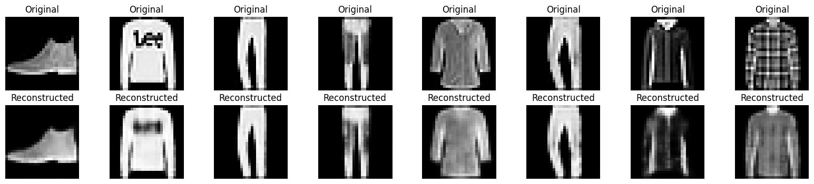

**Epoch 10 (Fashion-MNIST)**

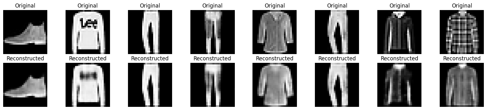

**CIFAR-100.** The difference from Fashion-MNIST is clear. The reconstructions mainly preserve the global color distribution and some broad regions, but objects are no longer clearly identifiable. Contours fade, textures disappear, and semantic elements (people, animals, or objects) are reduced to color blobs. This suggests that the latent bottleneck is not sufficient to represent the visual and semantic complexity of CIFAR-100.

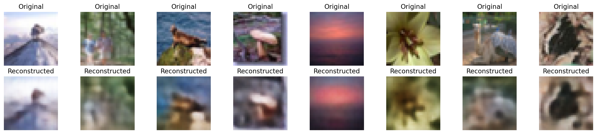

### t-SNE structure

**Fashion-MNIST.** The t-SNE plot shows that some classes form relatively clear groupings. In particular, Sneaker and Ankle boot appear as compact, well-separated clusters, while Bag also tends to concentrate in a specific region. In contrast, several upper-body garment classes—such as T-shirt/top, Shirt, Pullover, and Coat—overlap considerably, indicating that the latent space does not strongly distinguish between visually similar categories.

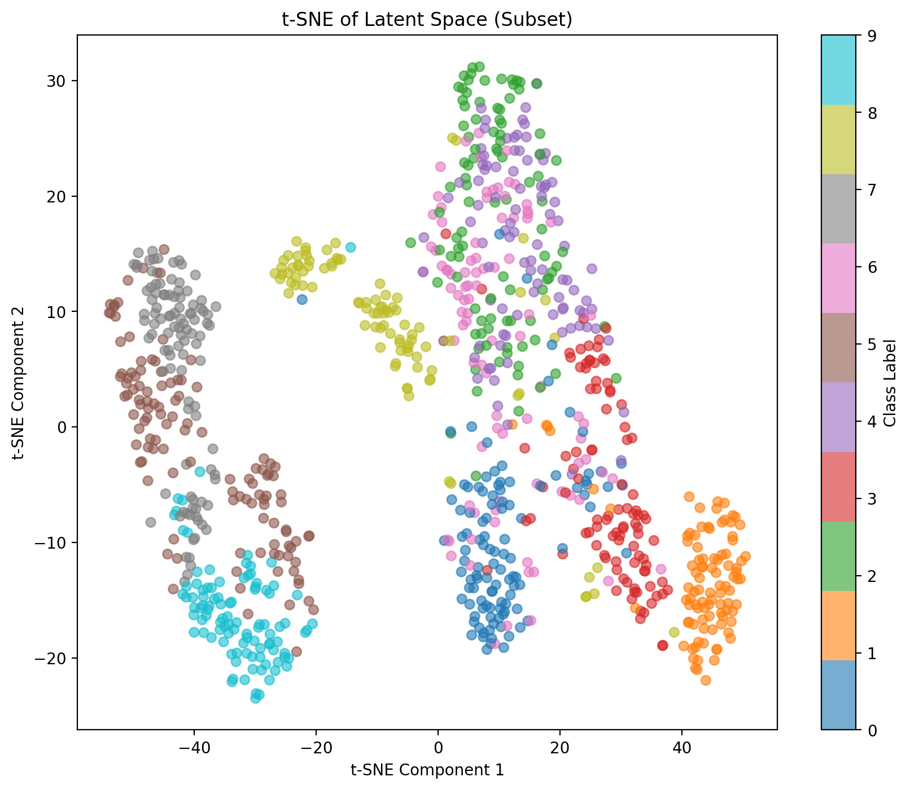

**CIFAR-100.** Points from the 100 classes are heavily mixed, with no clusters clearly associated with semantic labels. The projection forms a continuous cloud where only small local groupings appear, and these do not consistently correspond to a single class. When increasing the latent dimensionality, the global structure changes slightly, but a clear class-wise separation still does not emerge, suggesting the issue is not solved by latent capacity alone.

**All CIFAR-100 classes (baseline latent)**

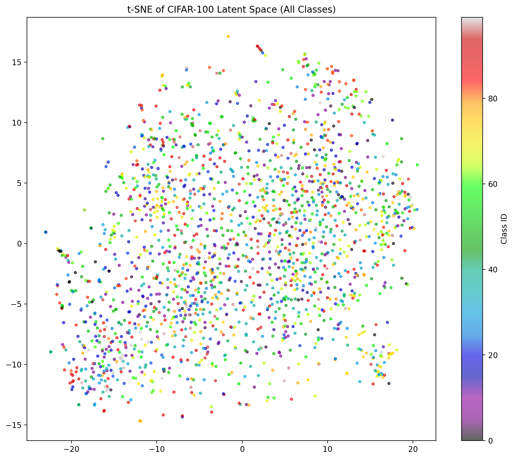

**All CIFAR-100 classes (512-dim latent)**

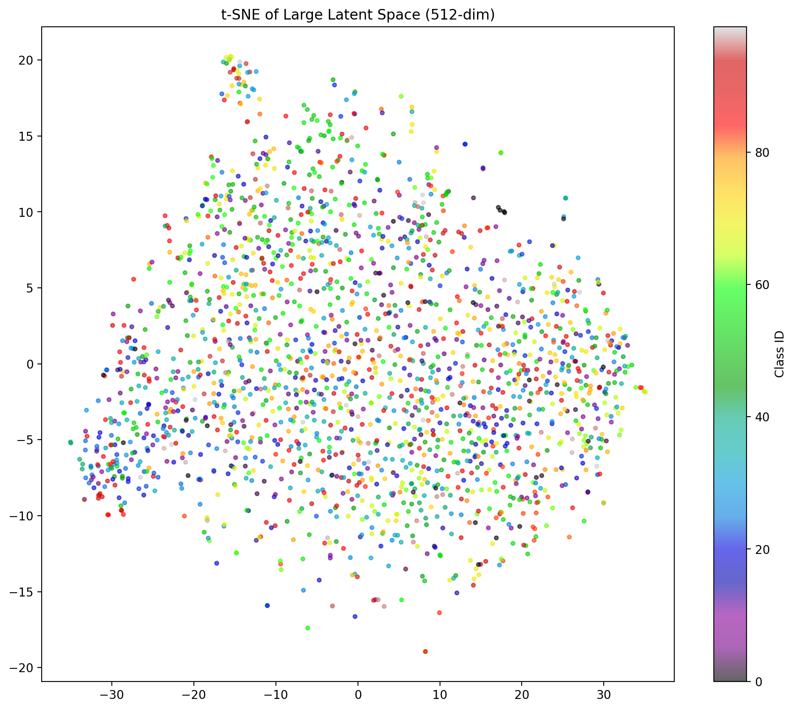

### Nearest-neighbor retrieval in latent space

In the k-NN example below, the query image is a T-shirt/top. Most of the nearest neighbors correspond to T-shirt/top, Shirt, and Coat, i.e., visually similar garments, although not always from the same class. This indicates that similarity in latent space is driven by overall appearance rather than the exact label.

When using a radius-based query, the retrieved set is smaller and excludes some more distant neighbors, but it still shows a mixture of related classes. Compared to fixed-size k-NN, the radius criterion produces a more locally coherent set, at the cost of returning fewer examples.

**Latent-space k-NN retrieval (k=12)**

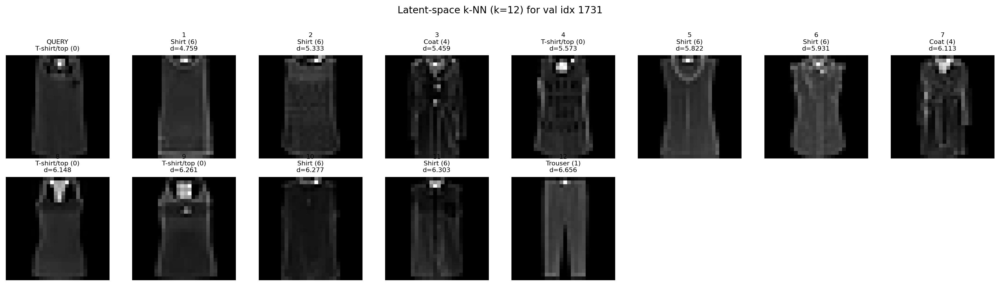

**Latent-space radius neighbors**

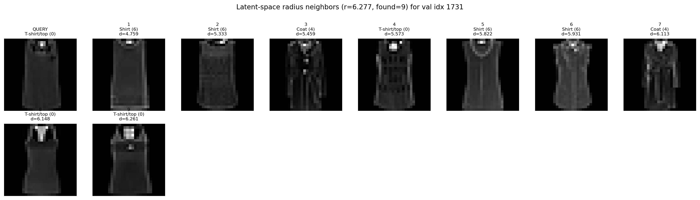

### Centroids and hybrids

**Class centroids.** The decoded average images show that some classes have highly recognizable centroids, such as Trouser, Sneaker, Bag, and Ankle boot, whose mean shape is clear and stable. In contrast, classes such as Shirt, Pullover, or Coat appear more diffuse and “washed out”, reflecting higher intra-class variability and the overlap observed in latent space.

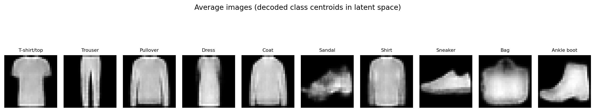

**Fashion-MNIST interpolations.** The change between T-shirt/top and Sneaker is gradual and smooth: the image stops looking clearly like a T-shirt around intermediate values a ≈ 0.4–0.5, where an ambiguous shape emerges that does not correspond to a real garment. From a ≳ 0.7, the shoe structure becomes dominant. A similar behavior is observed for Trouser to Bag, where the transition passes through unrealistic intermediate images, indicating that the interpolation leaves the data manifold.

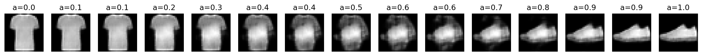

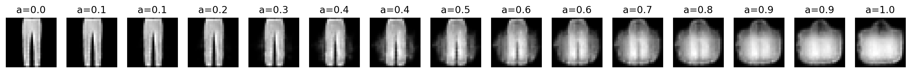

**CIFAR-100 interpolations.** Interpolations appear mainly as blends of color and texture, without a clear semantic transition between objects. Even in the model with a larger latent space, intermediate images remain difficult to interpret, suggesting the latent space is not semantically linear.

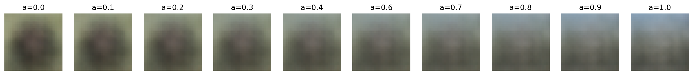

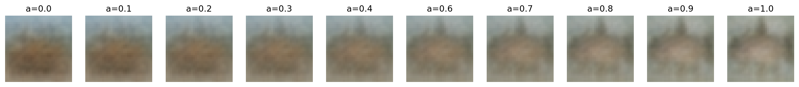

## Discussion

Several difficulties are inherent to the method. First, an autoencoder is optimized for reconstruction, not for class separation, so there is no guarantee that classes form tight, well-separated clusters in latent space. Second, t-SNE can exaggerate local clusters and distort global distances, so apparent separation should be interpreted cautiously. Third, interpolating between centroids (or between arbitrary points) may leave the true data manifold, which helps explain why hybrids can look unnatural. These issues were amplified on CIFAR-100 because the model must represent more complex variability with the same bottleneck.

To alleviate these difficulties, experiments included increasing the latent dimensionality (e.g., using a larger latent space on CIFAR-100), using deeper convolutional architectures, training longer, and subsampling data for more stable t-SNE plots. Class centroids were also used to reduce noise from individual samples when comparing classes, even though centroid decoding is not guaranteed to yield a realistic image.

The method's difficulties are clearly reflected in the figures. The overlap in the Fashion-MNIST t-SNE helps explain the class mixing observed in nearest-neighbor retrieval. In CIFAR-100, blurry reconstructions and the lack of clusters in t-SNE are consistent with the poorly interpretable interpolations, which reduce to color mixing rather than smooth semantic transformations.

## Conclusion

Overall, the figures show that the autoencoder learns a latent space that is useful for capturing coarse visual similarity on Fashion-MNIST, but with limited separation between nearby classes. On CIFAR-100, higher visual complexity leads to blurry reconstructions and a weakly structured latent space, and interpolations are difficult to interpret semantically. These results confirm that reconstruction loss alone is not sufficient to induce a rich semantic organization on complex datasets.

Key limitations of this approach are that:

- (i) autoencoders optimize reconstruction rather than semantic separation

- (ii) the latent space is not guaranteed to be linear or “meaningful” for interpolation

- (iii) decoded centroids and interpolations can leave the data manifold and produce unrealistic images

- (iv) t-SNE can be unstable and does not preserve global distances

Possible extensions include variational autoencoders (to regularize the latent space), contrastive or metric learning objectives (to explicitly shape distances), class-conditional models, and perceptual losses that better align reconstructions with human judgments of similarity.
